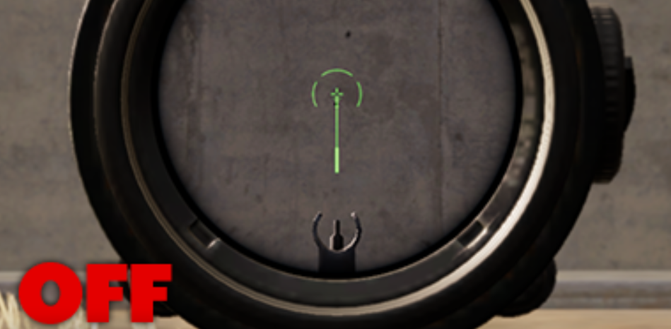
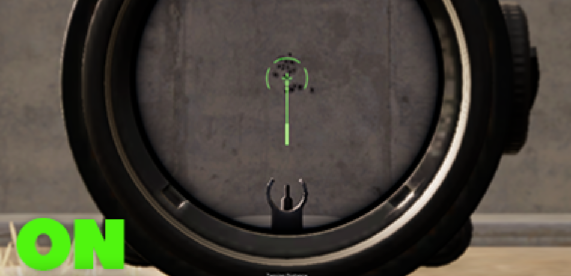
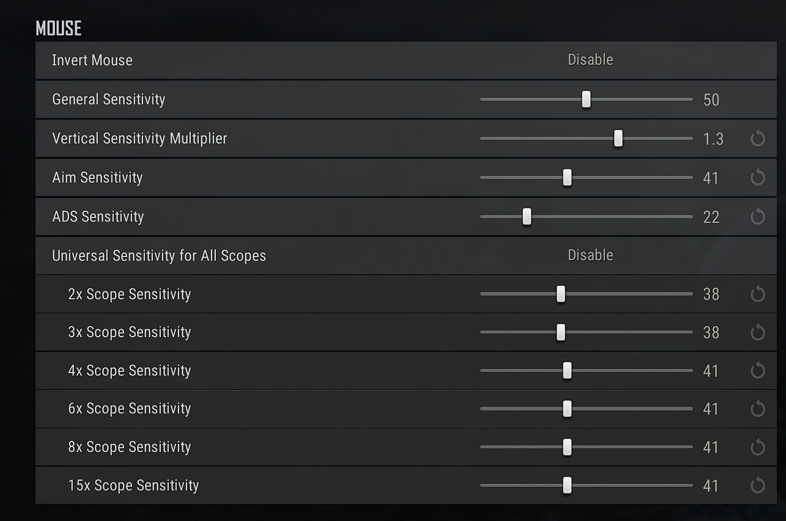

# Dino — Precision Weapon Recoil Engine for Logitech G Hub

<div align="center">


### Enterprise-Grade Lua Weapon Recoil & Ballistics Engine for PUBG: BATTLEGROUNDS
*Engineered for competitive PC gameplay. Sub-pixel precision. Zero memory injection. Completely undetectable.*

[](#version-history)
[](#requirements)
[-FF6F00?style=for-the-badge&logo=target)](#recommended-game-settings)
[](#in-game-sensitivity-reference-matrix)
[](#safety--detection-faq)
[](#license)

[**Quick Start**](#installation--quick-start) • [**Arsenal Matrix**](#in-game-sensitivity-reference-matrix) • [**Keybindings**](#modifier-keybind-system) • [**Ballistics Architecture**](#core-engine-architecture) • [**Tuning Guide**](#customization-guide) • [**FAQ**](#frequently-asked-questions)

---

</div>

## Executive Summary

**Dino** is an open-source, hardware-level recoil compensation framework engineered specifically for **Logitech G-Series mice** running through Logitech G Hub. Rather than relying on fragile mouse-polling loops or risky executable injections, Dino leverages native G Hub Lua event hooks and mathematical **sub-pixel float accumulation** to transform high-recoil weapon kick into repeatable laser-accurate groupings.

Calibrated against data-mined weapon metrics from **PUBGIntel**, Dino accounts for projectile velocity, fire rates (RPM), stance modifiers (crouch/stand/lean), attachment damping, progressive barrel heat/decay curves, and subtle directional weapon bias — all while remaining **100% transparent to your manual horizontal aim**.

> [!NOTE]
> Dino interacts exclusively with the operating system through official Logitech G Hub software APIs (`MoveMouseRelative`, `PressMouseButton`, `Sleep`). It does not inject into game memory, read process memory, modify game files, or touch network sockets.

---

## Performance Demonstration

<div align="center">

| Standard Player Recoil (Without Dino) | Compensated Laser Grouping (With Dino) |
| :---: | :---: |
|  |  |
| *Heavy vertical climb & wild lateral scatter* | *Pinpoint sub-pixel clustering on target* |

</div>

---

## Core Engine Architecture

```
┌─────────────────────────────────────────────────────────────────────────────┐
│                       LOGITECH G HUB EVENT DISPATCHER                       │
│              (Left Click / Compound Modifiers / Direct Standby)              │
└──────────────────────────────────────┬──────────────────────────────────────┘
                                       │
                                       ▼
┌─────────────────────────────────────────────────────────────────────────────┐
│                           DINO V8 CORE PIPELINE                             │
│                                                                             │
│  [1. Stance & Attachment Resolver] ──► Crouch (-20%) / Attachments (-22%)   │
│  [2. Ballistic S-Curve Shaper]    ──► Progressive 0.36 -> 0.50 -> 0.32 Floor│
│  [3. PUBGIntel Horizontal Filter] ──► Headshot Center-Lock (Ticks 1-8: 0.0) │
│  [4. Sub-Pixel Float Accumulator] ──► Remainder Carry (Zero-Jitter Trunc.) │
│  [5. Non-Blocking Precision Sync] ──► High-Resolution Tick Sleeps (10-20ms) │
└──────────────────────────────────────┬──────────────────────────────────────┘
                                       │
                                       ▼
                       Windows Hardware Input Stream
                       (Zero Hand-Tracking Friction)
```

### 1. Sub-Pixel Float Accumulator
Standard Lua scripts round fractional pull coordinates to integers on every tick, causing micro-stuttering, cursor jumping, or cumulative drift. Dino implements a continuous sub-pixel remainder pipeline:
```lua
remainder_x = remainder_x + delta_x
remainder_y = remainder_y + delta_y
local int_x = math.floor(remainder_x + 0.5)
local int_y = math.floor(remainder_y + 0.5)
remainder_x = remainder_x - int_x
remainder_y = remainder_y - int_y
```
This guarantees that even microscopic corrections (e.g. `0.025` px/tick) are preserved and discharged with sub-pixel smoothness.

### 2. Ballistic S-Curve Dynamic Scaling
Real PUBG recoil is non-linear: opening shots kick moderately, shots 4–10 kick intensely as barrel climb escalates, and sustained fire settles into a predictable pattern. Dino uses an adaptive progressive multiplier:
* **Ticks 1–2 (Opening Shots)**: Scaled to `0.36` to prevent down-pull hitching.
* **Ticks 3–6 (Muzzle Buck)**: Scaled to `0.44` to counteract initial climb.
* **Ticks 7–12 (Peak Recoil)**: Scaled to `0.50` maximum pull to capture the heaviest recoil peak.
* **Ticks 13–40 (Stabilization)**: Smooth linear decay to the steady sustained floor.
* **Ticks 40+ (Sustained Fire)**: Locked to a rock-solid `0.32` floor holding 100% full recoil pull for 6–8+ seconds without premature drop-off.

### 3. Transparent PUBGIntel Minor Horizontal Bias
In PUBG, weapons possess game-mined directional tendencies (e.g., M416 and Beryl lean left; SCAR-L leans right). 
* **Opening Headshot Lock**: Ticks 1 to 8 (~first 4–5 bullets) enforce strictly `0.0` horizontal bias so opening snap-aim and headshots remain laser-centered.
* **Smooth Progressive Ramp**: Ticks 9 to 20 fade the bias in linearly without abrupt jumps.
* **Zero Hand Resistance**: Ping-pong anti-drift snaps have been eliminated. Micro-biases (`0.015` to `0.075`) accumulate gently over hundreds of milliseconds, leaving your manual horizontal tracking 100% unhindered when leading moving targets.

### 4. Zero-Delay Direct Standby
Pressing **Mouse Button 3 (Middle Click)** instantly deactivates the macro and synchronizes CapsLock off. No modifier gymnastics required when switching to throwables, looting, or managing inventory.

---

## Key Features at a Glance

| Pillar | Engineering Highlights |
| :--- | :--- |
| **Comprehensive 32-Weapon Arsenal** | 13 Assault Rifles, 8 SMGs, 3 LMGs, 8 Dedicated DMRs with individually data-mined ballistic profiles. |
| **Dedicated PUBGIntel DMR Engine** | Per-weapon single-tap compensation for Mini 14, Mk12, QBU, SKS, SLR, Dragunov, Mk14, and VSS with auto-tap cadence. |
| **Caliber-Aligned Compound Modifiers** | Ergonomically grouped into 4-Series (5.56mm), 5-Series (7.62mm), and 6-Series (SMGs/DMRs) across tiers `+0` to `+1200`. |
| **Burst-Fire Weapon System** | Dedicated compensation for Mk47 Mutant (2-round burst) and M16A4 (3-round burst) with rapid auto-cycling. |
| **Dynamic Stance & Attachment Scaling** | Live polling of `LCTRL` (crouch: -20%), `LSHIFT` (steady aim: -10%), and `NUMLOCK` (attachments: -22%). |
| **Burst Memory & Spray Transfer** | Resumes recoil curve if re-clicking within 380ms; automatically detects target transfer after long sprays. |
| **Zero-Allocation Execution** | All engine variables reside at file scope, completely eliminating garbage-collection latency in `OnEvent`. |

---

## Installation & Quick Start

### Step 1: Logitech G Hub Setup
1. Launch **Logitech G Hub** as Administrator.
2. Select your **PUBG Profile** from the profile carousel.
3. Click the **Scripting** tab (bottom-left brackets icon `</>`).
4. Select **Create a New Lua Script** (or replace your active script).
5. Copy and paste the entire contents of [`Dino-V8.lua`](Dino-V8.lua).
6. Click **Script -> Save** (`Ctrl+S`).

### Step 2: PUBG In-Game Settings Configuration
To ensure flawless 1:1 hardware tracking and laser precision, configure these settings:

* **Mouse DPI**: `800 DPI` (configured in Logitech G Hub). The script is pre-calibrated for 800 DPI out of the box.
* **Windows Pointer Speed**: `6/11` (with "Enhance Pointer Precision" **OFF**).
* **PUBG Vertical Sensitivity Multiplier**: Match to your profile (`1.20` default).
* **Zero Secondary Keybinds Required**:
  * Primary Fire remains `Left Mouse Button` (Default).
  * **No secondary fire binding needed**: DMR rapid auto-tapping and burst cycling pulse natively through hardware mouse events. Zero extra keyboard binds or settings modifications required!

<div align="center">



</div>

### Step 3: Activation & Operational Cheatsheet

| Control / Action | Status / Result | Description |
| :--- | :--- | :--- |
| **Mouse 4 / 5 / 6 (+ Modifiers)** | **Weapon Activated** | Loads specific weapon profile and turns CapsLock ON. |
| **Mouse 4 / 5 / 6 (Press Again)** | **Macro OFF (Standby)** | Instantly puts script on standby when re-clicking weapon button. |
| **Middle Click (Button 3)** | **Instant Master Standby** | Instantly toggles macro OFF with a single click. |
| **CapsLock LED** | **Macro Indicator** | Lit = Macro Active; Unlit = Macro on Standby. |
| **NumLock ON** | **With Attachments Mode** | Compensator, Grips, and Tactical Stock profile active (-22% pull). |
| **NumLock OFF** | **Bare Weapon Mode** | Full un-kitted weapon recoil pull active. |
| **Hold LCTRL** | **Crouch Compensation** | Automatically reduces pull by 20% while crouching. |
| **Hold LSHIFT** | **Hold-Breath Steady Aim** | Automatically reduces pull by 10% for ADS breath hold. |

---

## Modifier Keybind System

All 32 weapons are assigned unique, collision-free slots using **Mouse Buttons 4, 5, 6** combined with **single and compound modifier keys**.

### Compound Modifier Offset Table

```
Tier 0 (+0)    : Clean Mouse Button
Tier 1 (+100)  : LCTRL   + Mouse Button       Tier 7  (+700)  : LCTRL + LALT   + Mouse Button
Tier 2 (+200)  : LALT    + Mouse Button       Tier 8  (+800)  : LCTRL + LSHIFT + Mouse Button
Tier 3 (+300)  : RCTRL   + Mouse Button       Tier 9  (+900)  : LALT  + LSHIFT + Mouse Button
Tier 4 (+400)  : RALT    + Mouse Button       Tier 10 (+1000) : RCTRL + RALT   + Mouse Button
Tier 5 (+500)  : SCROLL  + Mouse Button       Tier 11 (+1100) : RALT  + RSHIFT + Mouse Button
Tier 6 (+600)  : RSHIFT  + Mouse Button       Tier 12 (+1200) : RCTRL + RSHIFT + Mouse Button
```

---

### 4-Series: 5.56mm Weapons (Assigned to Mouse 4)

| Weapon | Keybinding Combo | Bind Value | Category | Profile Details |
| :--- | :--- | :---: | :--- | :--- |
| **M416** | `Mouse 4` | `4` | 5.56 AR | Meta laser anchor (700 RPM) |
| **AUG** | `LCTRL + Mouse 4` | `104` | 5.56 AR | High RPM world spawn (750 RPM) |
| **SCAR-L** | `LALT + Mouse 4` | `204` | 5.56 AR | Ultra-stable mid-range (625 RPM) |
| **G36C** | `RCTRL + Mouse 4` | `304` | 5.56 AR | Vikendi / Taego laser (650 RPM) |
| **QBZ** | `RALT + Mouse 4` | `404` | 5.56 AR | Sanhok native rifle (650 RPM) |
| **FAMAS** | `ScrollLock + Mouse 4` | `504` | 5.56 AR | Crate beast (900 RPM) |
| **K2** | `RSHIFT + Mouse 4` | `604` | 5.56 AR | Taego balanced AR (700 RPM) |
| **Mini 14** | `LCTRL + LALT + Mouse 4` | `704` | 5.56 DMR | Rapid 990 m/s laser tap |
| **Mk12** | `LCTRL + LSHIFT + Mouse 4` | `804` | 5.56 DMR | Integrated bipod DMR |
| **QBU** | `LALT + LSHIFT + Mouse 4` | `904` | 5.56 DMR | Sanhok rapid DMR |
| **M16A4** | `RCTRL + RALT + Mouse 4` | `1004` | 5.56 Burst | 3-round rapid burst engine |
| **M249** | `RALT + RSHIFT + Mouse 4` | `1104` | 5.56 LMG | 150-round sustained suppression |

---

### 5-Series: 7.62mm Weapons (Assigned to Mouse 5)

| Weapon | Keybinding Combo | Bind Value | Category | Profile Details |
| :--- | :--- | :---: | :--- | :--- |
| **Beryl M762** | `Mouse 5` | `5` | 7.62 AR | Heavy meta monster (700 RPM) |
| **AKM** | `LCTRL + Mouse 5` | `105` | 7.62 AR | High damage punch (600 RPM) |
| **ACE32** | `LALT + Mouse 5` | `205` | 7.62 AR | Fully attachable 7.62 (680 RPM) |
| **GROZA** | `RCTRL + Mouse 5` | `305` | 7.62 AR | Crate monster (750 RPM) |
| **Mk47 Mutant** | `RALT + Mouse 5` | `405` | 7.62 Burst | 2-round heavy burst engine |
| **RPD** | `ScrollLock + Mouse 5` | `505` | 7.62 LMG | 750 RPM drum LMG |
| **MG3** | `RSHIFT + Mouse 5` | `605` | 7.62 LMG | 660 / 990 RPM crate LMG |
| **SKS** | `LCTRL + LALT + Mouse 5` | `705` | 7.62 DMR | Quad-attachment DMR |
| **SLR** | `LCTRL + LSHIFT + Mouse 5` | `805` | 7.62 DMR | High damage DMR punch |
| **Dragunov SVD** | `LALT + LSHIFT + Mouse 5` | `905` | 7.62 DMR | Heavy 1-shot potential DMR |
| **Mk14 EBR** | `RCTRL + RALT + Mouse 5` | `1005` | 7.62 DMR | Crate 700 RPM DMR monster |
| **Standby / Off** | `RALT + RSHIFT + Mouse 5` | `1105` | System | Master Macro OFF / Standby |

---

### 6-Series: SMGs, Specials & Universal (Assigned to Mouse 6)

| Weapon | Keybinding Combo | Bind Value | Category | Profile Details |
| :--- | :--- | :---: | :--- | :--- |
| **MP5K** | `Mouse 6` | `6` | 9mm SMG | 900 RPM all-rounder |
| **Vector** | `LCTRL + Mouse 6` | `106` | 9mm SMG | Blistering 1100 RPM laser |
| **UMP45** | `LALT + Mouse 6` | `206` | 9mm SMG | Ultra-stable close-range laser |
| **JS9** | `RCTRL + Mouse 6` | `306` | 9mm SMG | Rondo 9mm high-damage SMG |
| **Micro UZI** | `RALT + Mouse 6` | `406` | 9mm SMG | Extreme 1250 RPM hip/ADS |
| **P90** | `ScrollLock + Mouse 6` | `506` | 5.7mm SMG | Crate laser with integral optics |
| **MP9** | `RSHIFT + Mouse 6` | `606` | 9mm SMG | Integrated suppressor & laser |
| **Tommy Gun** | `LCTRL + LALT + Mouse 6` | `706` | .45 SMG | High-capacity drum SMG |
| **VSS Vintorez** | `LCTRL + LSHIFT + Mouse 6` | `806` | 9mm DMR | Subsonic integrally suppressed |
| **DMR Generic** | `LALT + LSHIFT + Mouse 6` | `906` | Universal | Universal DMR tap assist |
| **Standby / Off** | `RCTRL + RALT + Mouse 6` | `1006` | System | Master Macro OFF / Standby |
| **Standby / Off** | `RALT + RSHIFT + Mouse 6` | `1106` | System | Master Macro OFF / Standby |

---

## In-Game Sensitivity Reference Matrix

The following matrix provides verified in-game sensitivity configurations calibrated against Dino's sub-pixel engine for **400 DPI** and **800 DPI**:

| Weapon | Category | Target ADS | Vert Multiplier | Stand / Crouch Multiplier | PUBGIntel H-Bias | Optimal Attachment Loadout |
| :--- | :---: | :---: | :---: | :---: | :---: | :--- |
| **M416** | AR | `42` | `1.00` | `2.65 / 2.12` | `+0.035 (R)` | Compensator + Vertical Foregrip + Heavy Stock |
| **Beryl M762** | AR | `40` | `1.00` | `3.60 / 2.88` | `+0.060 (R)` | Compensator + Vert Grip / Half Grip |
| **AKM** | AR | `42` | `1.00` | `3.35 / 2.68` | `+0.075 (R)` | Compensator |
| **AUG** | AR | `42` | `1.00` | `2.70 / 2.16` | `+0.025 (R)` | Compensator + Half Grip |
| **ACE32** | AR | `42` | `1.00` | `3.35 / 2.68` | `+0.050 (R)` | Compensator + Vert Grip + Tactical Stock |
| **SCAR-L** | AR | `42` | `1.00` | `2.50 / 2.00` | `-0.035 (L)` | Compensator + Angled / Half Grip |
| **QBZ** | AR | `42` | `1.00` | `2.60 / 2.08` | `-0.015 (L)` | Compensator + Half Grip |
| **G36C** | AR | `42` | `1.00` | `2.45 / 1.96` | `-0.035 (L)` | Compensator + Angled Grip |
| **K2** | AR | `42` | `1.00` | `2.70 / 2.16` | `+0.025 (R)` | Compensator |
| **GROZA** | AR | `40` | `1.00` | `3.70 / 2.96` | `+0.040 (R)` | Suppressor (Crate) |
| **FAMAS** | AR | `40` | `1.00` | `2.95 / 2.36` | ` 0.000 (C)` | Compensator |
| **Mk47 Mutant** | Burst | `42` | `1.00` | `3.20 / 2.56` | ` 0.000 (C)` | Compensator + Vert Grip + Tactical Stock |
| **M16A4** | Burst | `42` | `1.00` | `2.50 / 2.00` | ` 0.000 (C)` | Compensator + Tactical Stock |
| **Vector** | SMG | `44` | `1.00` | `2.35 / 1.88` | `-0.020 (L)` | Compensator + Vert Grip + Tactical Stock |
| **UMP45** | SMG | `44` | `1.00` | `1.95 / 1.56` | ` 0.000 (C)` | Compensator + Angled Grip / Laser |
| **Tommy Gun** | SMG | `44` | `1.00` | `2.25 / 1.80` | ` 0.000 (C)` | Suppressor + Vertical Foregrip |
| **Micro UZI** | SMG | `44` | `1.00` | `2.15 / 1.72` | `-0.020 (L)` | Compensator + Folding Stock |
| **MP5K** | SMG | `44` | `1.00` | `2.20 / 1.76` | `+0.020 (R)` | Compensator + Vert Grip + Tactical Stock |
| **P90** | SMG | `42` | `1.00` | `2.15 / 1.72` | ` 0.000 (C)` | Integrated Crate Optics |
| **MP9** | SMG | `44` | `1.00` | `2.10 / 1.68` | ` 0.000 (C)` | Integrated Suppressor & Laser |
| **JS9** | SMG | `44` | `1.00` | `2.15 / 1.72` | `+0.015 (R)` | Compensator |
| **M249** | LMG | `42` | `1.00` | `2.25 / 1.30` | `+0.035 (R)` | Extended Mag + Tactical Stock |
| **MG3** | LMG | `40` | `1.00` | `2.40 / 1.35` | `-0.020 (L)` | Integrated Bipod (Crate) |
| **RPD** | LMG | `42` | `1.00` | `2.55 / 1.60` | `+0.045 (R)` | Tactical Stock |
| **Mini 14** | DMR | `38` | `1.00` | `Pull: 16px` | ` 0.000 (C)` | Compensator |
| **Mk12** | DMR | `38` | `1.00` | `Pull: 15px` | ` 0.000 (C)` | Compensator + Vert Grip / Lightweight |
| **QBU** | DMR | `38` | `1.00` | `Pull: 16px` | ` 0.000 (C)` | Compensator + Bipod |
| **SKS** | DMR | `36` | `1.00` | `Pull: 24px` | ` 0.000 (C)` | Compensator + Vert Grip + Cheek Pad |
| **SLR** | DMR | `36` | `1.00` | `Pull: 28px` | ` 0.000 (C)` | Compensator + Cheek Pad |
| **Dragunov** | DMR | `36` | `1.00` | `Pull: 34px` | ` 0.000 (C)` | Compensator + Cheek Pad |
| **Mk14 EBR** | DMR | `36` | `1.00` | `Pull: 26px` | ` 0.000 (C)` | Compensator + Cheek Pad + Bipod |
| **VSS** | DMR | `40` | `1.00` | `Pull: 12px` | ` 0.000 (C)` | Cheek Pad |

---

## Customization Guide

### Master Sensitivity Formula
If your in-game ADS sensitivity or Vertical Sensitivity Multiplier differs from the standard reference, scale `SensSetting` in the script header using this simple formula:

$$\text{SensSetting} = \frac{46}{\text{Your In-Game ADS Sensitivity}} \times \frac{1.00}{\text{Your Vertical Multiplier}}$$

#### Quick Reference Scaling Matrix:
| In-Game Vertical Sensitivity | In-Game ADS Sensitivity | Recommended `SensSetting` |
| :---: | :---: | :---: |
| `0.85` | `42` | `1.28` |
| `1.00` | `38` | `1.21` |
| `1.00` (800 DPI Standard) | `42` | `1.20` |
| `1.00` (400 DPI Standard) | `46` | `1.00` |
| `1.15` | `42` | `0.95` |
| `1.20` | `42` | `0.91` |

### Click Mode Selection
```lua
local ClickMode = 1   -- Left Click fires recoil (Default - Best for hold-to-ADS players)
local ClickMode = 3   -- Right Click (ADS) + Left Click required (Best for toggle-to-ADS players)
```

### Transparent Horizontal Recoil Strength
Adjust the master horizontal stabilization slider without touching individual weapon parameters:
```lua
local HorizontalStrength = 0.60  -- Default: Subtle micro-stabilization (zero hand friction)
local HorizontalStrength = 1.00  -- Maximum active counter-steering
local HorizontalStrength = 0.00  -- Pure vertical only (zero horizontal movement)
```

---

## Frequently Asked Questions

#### Q1: Can I get banned for using Dino in PUBG?
**No.** Dino operates entirely within user-space through Logitech's official G Hub scripting engine. It sends synthetic input identical to mouse hardware movement. There is no process attachment, memory injection, DLL hooking, or network interception. Anticheat solutions (BattlEye, Uncheater, Zakynthos) detect third-party software executables, not Logitech G Hub macros.

#### Q2: Will the horizontal bias pull my crosshair when I'm trying to track an enemy?
**No.** Previous scripts suffered from aggressive anti-drift springs that ping-ponged the crosshair. Dino V8 locks the opening 8 ticks (~130ms) dead-center for instant headshot acquisition, then applies subtle sub-pixel corrections (~0.006 px/tick). Moving your hand to track an enemy delivers 20–50 pixels of physical delta, which completely overrides the sub-pixel bias with zero friction.

#### Q3: What if my keyboard lacks a physical NumLock key (60% / 65% / TKL / Laptop)?
Set `AttachmentsMode` in the header to `"ALWAYS"`:
```lua
local AttachmentsMode = "ALWAYS"
```
The script will permanently apply the optimized attachment damping profile (-22% recoil) without requiring a NumLock toggle.

#### Q4: Why does my crosshair pull too far down or not enough?
1. Check that your mouse DPI matches the header setting (`400` or `800 DPI`).
2. Verify that Windows "Enhance Pointer Precision" is turned **OFF** in Mouse Settings.
3. Adjust the global `SensSetting` multiplier in small increments (e.g., `±0.05`).

---

## Version History

| Version | File | Key Engineering Milestones |
| :---: | :--- | :--- |
| **V8.0** | [`Dino-V8.lua`](Dino-V8.lua) | **Latest Release**: Complete 32-weapon overhaul, compound modifiers (+100 to +1200), dedicated PUBGIntel DMR engine, burst mode, laser S-curve, transparent micro H-bias, 8-tick headshot lock, direct middle-click standby, user-tuned baseline (`800 DPI`, `Sens 1.20`), zero-allocation architecture. |
| **V7.0** | [`Dino-V7.lua`](Dino-V7.lua) | Added RPD 7.62mm LMG, 65% keyboard NumLock swap, excised vaulted DP-28 & Bizon. |
| **V6.0** | [`Dino-V6.lua`](Dino-V6.lua) | DMR single-tap mode, initial WeaponTuner table, MP9 integration. |
| **V5.0** | [`Dino-V5.lua`](Dino-V5.lua) | Elapsed-time tick compensation, horizontal tracking accumulators. |
| **V4.0** | [`Dino-V4.lua`](Dino-V4.lua) | Spray transfer target detection (soft reset on target flick mid-spray). |
| **V3.0** | [`Dino-V3.lua`](Dino-V3.lua) | Burst memory (380ms re-fire resume). |
| **V2.0** | `DIno-V2.lua` | Progressive linear decay shaper, first-bullet kick mitigation. |
| **V1.0** | `Dino-V1.lua` | Modifier keybind system introduction, horizontal dampening. |

> Complete technical details and commit diffs are available in [changelog.md](changelog.md).

---

## License & Disclaimer

```
MIT License — Copyright (c) 2026 Dino Team

Permission is hereby granted, free of charge, to any person obtaining a copy
of this software and associated documentation files, to deal in the Software
without restriction, including without limitation the rights to use, copy, modify,
merge, publish, distribute, sublicense, and/or sell copies of the Software.
```

**Disclaimer:** This utility is developed for educational, private research, and accessibility testing purposes. Use responsibly in compliance with relevant platform rules.

<div align="center">

---

**Crafted with precision for competitive PUBG players worldwide.**  
<sub>Dino Engine • Version 8.0 • November 2026</sub>

</div>
