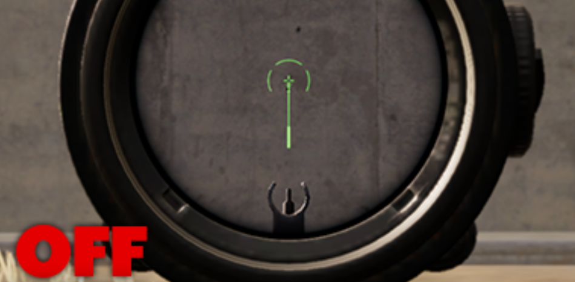
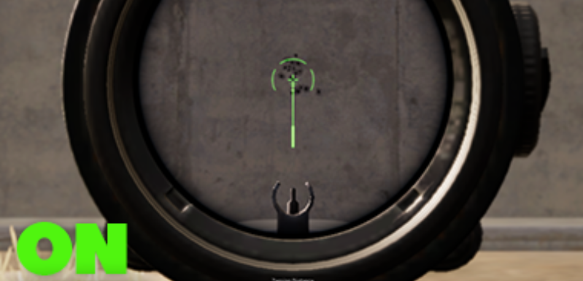
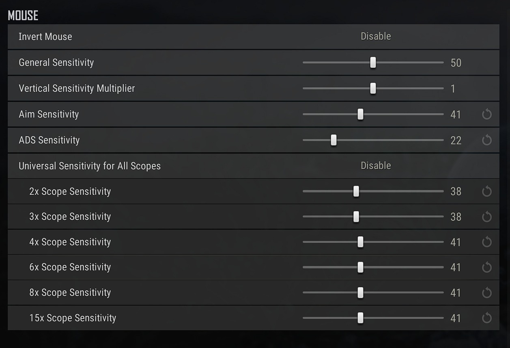

# Dino — Logitech G Hub Recoil Engine for PUBG: BATTLEGROUNDS

<div align="center">


### Hardware-Level Lua Recoil Engine for Logitech G-Series Mice
*Clean, non-intrusive recoil compensation utilizing native Logitech G Hub Lua APIs.*

[](#quick-start)
[](#quick-start)
[](#recommended-system--game-settings)
[](#recommended-system--game-settings)
[](#license)

[**Overview**](#overview) • [**Demonstration**](#recoil-demonstration) • [**System & Game Settings**](#recommended-system--game-settings) • [**Quick Start**](#quick-start) • [**How It Works**](#how-it-works)

---

</div>

## Overview

**Dino** is a lightweight, hardware-level recoil compensation framework written for **Logitech G-Series mice** running through **Logitech G Hub**. It operates entirely within Logitech's native scripting environment, using official input automation functions (`MoveMouseRelative`, `PressMouseButton`, `Sleep`) to deliver smooth, consistent spray control.

- **Non-Intrusive**: Does not touch game memory, inject DLLs, read processes, or modify game files.
- **Dynamic Compensation**: Applies real-time adjustments for standing, crouching, breathing, and weapon attachments.
- **Adaptive Cadence**: Supports full-auto rifles, burst weapons, and continuous auto-tapping for designated marksman rifles (DMRs).

---

## Recoil Demonstration

<div align="center">

### Without Script (Default Recoil)


### With Script (Dino Active)


</div>

---

## Recommended System & Game Settings

To ensure 1:1 hardware synchronization and optimal tracking accuracy, configure your system and in-game settings as follows:

| Setting | Value | Notes |
| :--- | :--- | :--- |
| **Mouse Hardware DPI** | **800 DPI** | Set in your Logitech G Hub profile. |
| **Windows Pointer Speed** | **6 -- 11** | Windows default 6th notch; ensures unscaled 1:1 input. |
| **Mouse Acceleration** | **OFF** | Uncheck **"Enhance pointer precision"** in Windows Mouse Properties. |
| **In-Game Sensitivity** | Reference Screenshot | Calibrated for 1.00 sensitivity profile baseline. |

<div align="center">



</div>

---

## Quick Start

1. Open **Logitech G Hub** as Administrator.
2. Select your **PUBG Profile** from the main dashboard.
3. Click the **Scripting** icon (`</>`) at the bottom of the screen.
4. Select **Create a New Lua Script** (or edit your existing script).
5. Copy and paste the complete contents of [`Dino-V11.lua`](Dino-V11.lua).
6. Save the script via **Script -> Save** (`Ctrl+S`).
7. Launch PUBG and test your profile in the Training Grounds.

---

## How It Works

Dino executes on an event-driven loop triggered whenever hardware inputs occur:

1. **Weapon Selection**: Pressing a weapon-bound mouse button (or Logitech G keyboard macro) switches active profiles. The physical **CapsLock LED** indicates whether the macro is armed.
2. **Input Interception**: When you hold the **Left Mouse Button (LMB)** to fire, the engine calculates the required vertical and horizontal correction offsets per millisecond tick.
3. **Stance & Modifier Detection**:
   - **Crouch**: Holding `LCTRL` (crouch) dynamically scales vertical pull down according to weapon-specific crouch modifiers.
   - **Hold Breath**: Holding `LSHIFT` applies steady-aim compensation.
   - **Attachments**: Toggling `NumLock ON` activates attachment compensation curves (compensators, foregrips, stocks).
4. **Sub-Pixel Motion Application**: Offsets are accumulated as floating-point values and applied through `MoveMouseRelative`, ensuring crosshair movement remains natural and completely responsive to manual mouse corrections.

---

## License

```
MIT License — Copyright (c) 2026 Dino Team

```

**Disclaimer:** This utility is developed for accessibility testing, private research, and educational purposes. Use responsibly in compliance with relevant platform terms.
